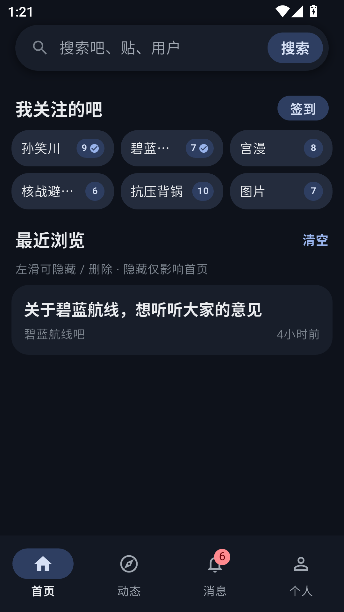
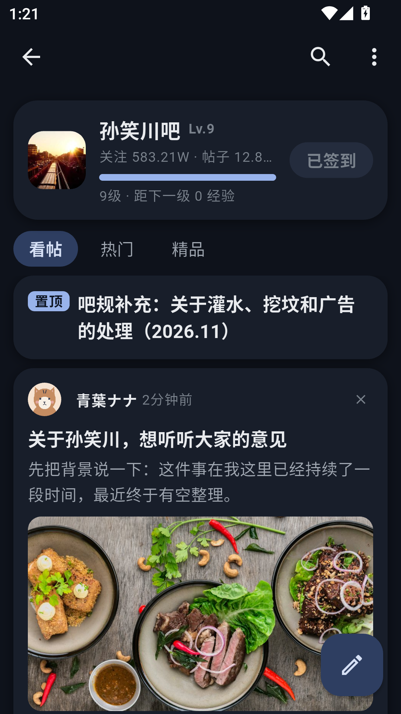
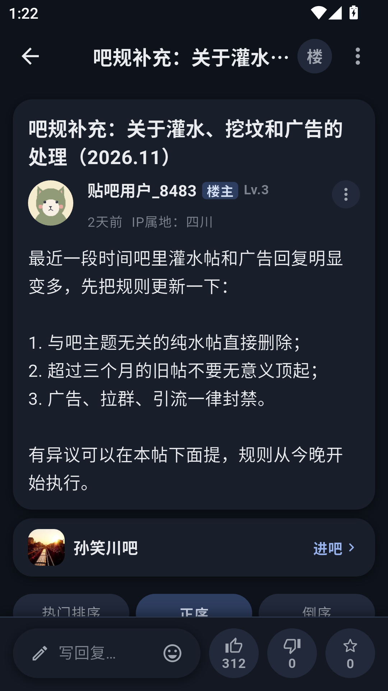
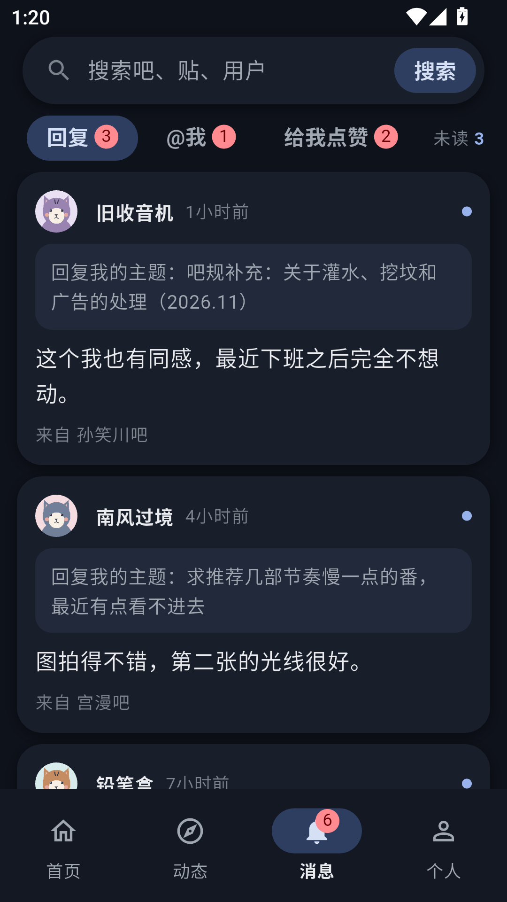
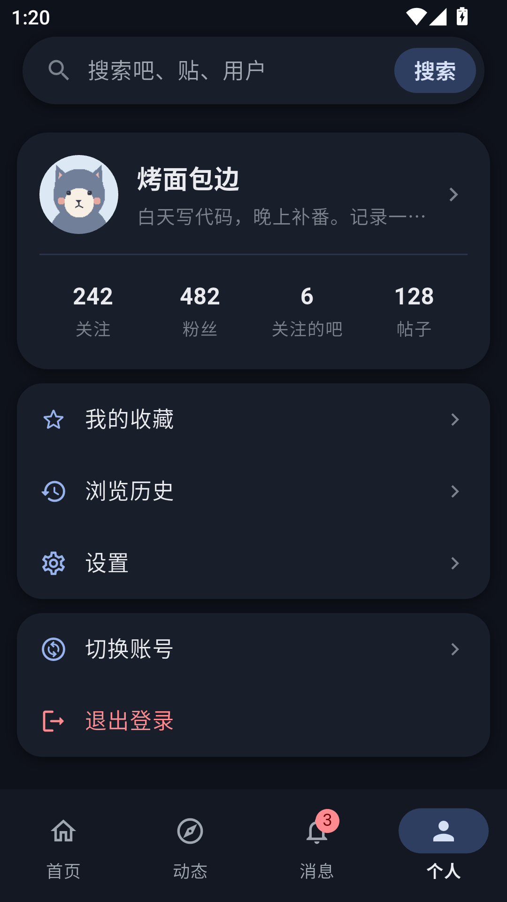

<div align="center">


# Tiebanana

**轻一点，逛贴吧。**

基于 Flutter 的第三方百度贴吧 Android 客户端 · **1.0.1**

[](LICENSE)
[](#下载安装)
[](https://github.com/Aobanana-chan/Tiebanana/releases)

[界面预览](#界面预览) · [功能](#日常功能) · [下载](#下载安装) · [构建](#从源码运行) · [开源范围与自定义后端](#开源范围与自定义后端)

</div>

Tiebanana 想把看帖、逛吧做得简约一些，
提供主题换色、深色模式和多账号切换。项目源于作者使用 TiebaLite 的经历，
现在作为一个持续维护的个人项目继续打磨。

## 界面演示

<table>
  <tr>
    <th>首页 · 关注的吧</th>
    <th>吧页 · 浏览主题</th>
    <th>帖子 · 楼层互动</th>
  </tr>
  <tr>
    <td></td>
    <td></td>
    <td></td>
  </tr>
  <tr>
    <th>消息 · 回复与提醒</th>
    <th>我的 · 个人</th>
    <th></th>
  </tr>
  <tr>
    <td></td>
    <td></td>
    <td></td>
  </tr>
</table>

## 日常功能

- **浏览**：关注吧、推荐动态、吧内分类与排序、图文楼层、楼中楼、图片查看和视频播放。
- **互动**：发帖、回帖、表情与图片、点赞、关注、收藏、单吧与一键签到。
- **消息**：回复、@我、点赞提醒。
- **查找**：帖子 / 吧 / 用户搜索、吧内搜索、浏览历史与收藏。
- **个性化**：七套主题色，浅色 / 深色 / 跟随系统，字号和图片加载策略可调。
- **其他体验**：多账号切换、收藏帖浏览缓存、贴吧链接跳转、应用内更新检查。

## 下载安装

到 [Releases](https://github.com/Aobanana-chan/Tiebanana/releases) 选择已发布版本的 APK。
安卓大多数手机选择 `app-arm64-v8a-release.apk`；较老的 32 位设备选择
`app-armeabi-v7a-release.apk`。如果你不知道自己应该选什么， 直接选择 `app-armeabi-v7a-release.apk`。


## 从源码运行

### 环境

- Flutter **3.47.x**（当前使用 3.47.7）与其自带的 Dart SDK。
- JDK 17、Android SDK，以及 Android 真机或模拟器。
- Git：用于拉取项目和公开契约子模块。

### 获取与启动

```bash
git clone https://github.com/Aobanana-chan/Tiebanana.git
cd Tiebanana
git submodule update --init packages/tieba_contract
flutter pub get
dart run build_runner build
flutter run
```

**只需初始化 `tieba_contract`**，不要使用 `--recurse-submodules`。
首次构建前需生成 ObjectBox 的 `lib/objectbox.g.dart`。

默认依赖 `packages/tieba_backend_demo`，无需 API 密钥或真实账号即可浏览主要页面。
该包Mock了虚拟的数据，进行页面的呈现。

若自己实现后端，可以加入 `pubspec_overrides.yaml` 文件，以使用自己的后端实现。

### 构建 APK

```bash
flutter build apk --split-per-abi
```

产物位于 `build/app/outputs/flutter-apk/`。

### 测试

```bash
flutter analyze
flutter test
```


## 代码导航

```text
lib/
├── app/                 启动、后端装配、路由与生命周期
├── core/                配置、缓存、日志与平台能力
├── features/            按功能组织的页面、组件、状态与数据
└── shared/              共享组件、内容渲染、媒体与主题
packages/
├── tieba_contract/      公开数据模型、后端接口与演示数据（子模块）
├── tieba_backend_demo/  默认演示后端装配包
└── headless_tieba/      私有贴吧 API 实现（可选子模块）
test/                   自动化测试
docs/screenshots/       README 界面截图
tool/                   开发工具与私有构建适配模板
```

界面采用 Flutter + Provider；历史功能使用 ObjectBox，设置功能使用 SharedPreferences。
主题由种子派生明暗配色，页面通过 `TiebananaTokens` 和语义字阶取用样式。

更多说明：[架构与依赖边界](docs/architecture.md) ·
[契约包](packages/tieba_contract/README.md) ·
[演示后端](packages/tieba_backend_demo/README.md) ·
[图标资源](docs/icon/README.md)

## 开源范围与自定义后端

**贴吧 API 部分闭源；开源范围为界面显示层与数据层**，包括应用界面、界面使用的数据模型、
`TiebaApi` 接口契约、本地存储及演示后端。闭源的是真实贴吧 API 的请求、认证与协议转换实现，
不包含在公开源码的许可范围内。防止滥用。

**任何人都可以实现对应的接口协议，完成自己的后端**，

接入路径：

1. 参照 [`TiebaApi`](packages/tieba_contract/lib/src/api/) 实现接口，返回 `tieba_contract` 定义的数据类。
2. 提供与 [`createTiebaApi`](packages/tieba_backend_demo/lib/tieba_backend_demo.dart) 一致的工厂入口，
   通过 `TiebaApiHost` 接收存储与提示等宿主能力。
3. 在自己的 `tieba_backend_demo` 替代包中导出该工厂，用根目录的
   `pubspec_overrides.yaml` 覆盖包路径；应用统一从 `lib/app/backend.dart` 装配后端。

例如，自己的替代包放在 `packages/my_backend`，且其 `pubspec.yaml` 包名为 `tieba_backend_demo`：

```yaml
# pubspec_overrides.yaml（本地文件，不入库）
dependency_overrides:
  tieba_backend_demo:
    path: packages/my_backend
```

重新执行 `flutter pub get` 后即可使用自己的实现。
现有私有后端的装配模板见
[`tool/private/pubspec_overrides.example.yaml`](tool/private/pubspec_overrides.example.yaml)，
仅供拥有相应仓库权限的维护者使用，公开构建不需要它。

## 参与与许可

欢迎通过 Issue 反馈问题，或通过 PR 改进界面、数据层与演示体验。
修改界面时请沿用 `TiebananaTokens` 与语义字体，避免硬编码颜色；提交中请清楚说明修改目的与内容。

公开代码以 [MIT License](LICENSE) 发布，具体权利与义务以许可证正文为准。

Tiebanana 为非官方个人项目，与百度公司无关联，亦未获其授权或认可。
百度贴吧的名称、商标和线上内容归各自权利人所有；演示数据仅用于展示界面。
请遵守相关法律法规与平台规则，不要将客户端或自建后端用于滥用服务。

感谢 TiebaLite 等前辈项目带来的启发。
